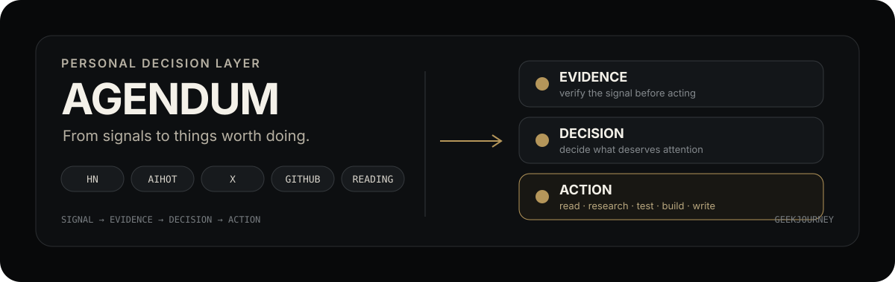

# Agendum

<p align="center">
  
</p>

> **From signals to things worth doing.**

Agendum is the decision layer for GeekJourney's personal research workflow.

It collects signals from HN, AI news, X, GitHub, newsletters, saved reading, and project discovery; verifies the evidence; decides what matters; and turns the few signals worth attention into concrete actions.

The goal is simple:

**Don't give me more information. Help me decide what to do next.**

---

## The loop

```text
Signals
  HN · AIHot · X · GitHub · Newsletters · Ideas
                         ↓
                    Aggregate
                         ↓
                 Deduplicate / Cluster
                         ↓
                  Verify Evidence
                         ↓
                     Judge
                         ↓
                    Decide
                         ↓
                      Act
                         ↓
              Read · Research · Test
          Build · Write · Post · Update
                    · Buy · Watch
```

Agendum sits after the information radars and before the work itself.

| Layer | Role |
| --- | --- |
| **Radar** | Find signals worth looking at |
| **Agendum** | Decide which signals deserve attention and action |
| **GitHub Issues** | Turn decisions into a visible action queue |
| **Projects / Content / Experiments** | Produce the real-world outcome |

---

## What counts as an action?

A signal becomes an Agendum only when there is a clear decision and a useful next step.

Typical actions:

- **READ** — read something worth understanding deeply
- **TRANSLATE** — translate a high-value article when appropriate
- **RESEARCH** — investigate a technology, trend, or opportunity
- **EXPERIMENT** — run a small test before committing to a build
- **BUILD** — create a product, tool, or open-source project
- **WRITE** — turn a validated observation into an article
- **POST** — share a useful insight on X
- **UPDATE** — improve a project, README, or personal website
- **DOMAIN** — evaluate or acquire a domain when the opportunity is real
- **BUY** — purchase a tool or service when there is a concrete reason
- **WATCH** — keep observing without forcing an action

The system should prefer **few high-confidence actions over a large backlog**.

---

## Evidence before action

Every meaningful decision should be traceable:

```text
Signal
  ↓
Original source
  ↓
Independent verification
  ↓
Context
  ↓
Reasoning
  ↓
Decision
  ↓
Next action
```

Primary evidence is preferred:

1. Official announcement
2. Official documentation
3. GitHub repository / release / commit
4. Original paper
5. Author or maintainer post
6. Hacker News discussion
7. High-quality secondary reporting

A popular post is a signal.

**Evidence is what makes it a decision.**

---

## Issue-driven workflow

GitHub Issues are the operational queue.

Recommended format:

```text
[READ] Deep read: ...
[RESEARCH] Investigate: ...
[EXPERIMENT] Test: ...
[BUILD] Prototype: ...
[WRITE] Article: ...
[POST] X thread: ...
[UPDATE] Website / README: ...
[DOMAIN] Evaluate: ...
[WATCH] Monitor: ...
```

A useful Issue should answer:

- **Decision** — what was decided?
- **Why** — why does it matter?
- **Signal** — what happened?
- **Evidence** — where is the proof?
- **Why it matters to GeekJourney** — what is the connection?
- **Recommended action** — what should happen next?
- **Expected outcome** — what will we learn or produce?
- **Effort** — how much time / complexity?
- **Priority** — P0 / P1 / P2
- **Sources** — can someone retrace the conclusion?

If those questions cannot be answered, the signal probably should not become an Issue yet.

---

## Research inputs

Agendum is designed to consume multiple upstream sources rather than becoming another news feed.

### Core

- Hacker News signals
- AI / Agent / Harness research
- AIHot
- GitHub projects and releases
- X first-hand signals
- X bookmarks and saved items
- X discussions from followed accounts
- Weekly Wisereads
- 阮一峰《科技爱好者周刊》
- Small creative projects and product opportunities

### Focus

Particular attention goes to:

- Agent and Coding Agent
- Harness engineering
- RSI / RRSI
- Model capability and post-training
- Agent benchmarks and evaluation
- Cost / task, steps, cache, latency, and long-running execution
- Developer tools and open source
- AI-native products
- Independent development and distribution
- Content systems and personal websites
- AI video and creative tooling
- Apple / iOS / Apple Watch experiments

---

## Decision rules

### Signal Value > Popularity

High points, stars, likes, or reposts do not automatically make something important.

### Experiment before building

When an idea can be tested cheaply, create an **EXPERIMENT** before a **BUILD**.

### One signal, one decision

If HN, X, GitHub, and AI news all describe the same development, consolidate the evidence into one decision.

### No forced actions

A quiet day is a valid result.

If nothing deserves action, record:

```text
Today: No Action
```

### Time is the scarce resource

The system should optimize for:

**less noise → better judgment → better use of time**

---

## Priority

| Priority | Meaning |
| --- | --- |
| **P0** | Act today; time-sensitive or strategically important |
| **P1** | Worth doing this week |
| **P2** | Useful backlog item |
| **WATCH** | Keep observing; no commitment yet |

The default bias is toward **P1 and small experiments**, not large commitments.

---

## Daily decision memo

The final daily output should be short:

```text
GeekJourney Action — YYYY-MM-DD

Valid signals: X
Actions created: X

P0
1. ...

P1
1. ...

Most important decision
...

Best thing to do today
...

Watch
...
```

The output is a decision memo, not a news dump.

---

## Weekly review

Once a week, consolidate:

- the strongest signals
- repeated patterns
- useful saved reading
- new projects
- emerging product opportunities
- unfinished actions
- decisions that changed
- actions to keep, drop, or double down on

The objective is to move from:

```text
Daily signals
    ↓
Weekly patterns
    ↓
Monthly trends
    ↓
Strategic thesis
```

---

## Repository structure

```text
agendum/
├── README.md
├── assets/
│   └── readme/
│       └── hero.svg
├── reports/
│   └── YYYY/
│       └── MM/
│           └── DD.md
├── weekly/
│   └── YYYY-WXX.md
├── actions/
│   └── YYYY/
│       └── MM/
│           └── DD.md
└── evidence/
    └── YYYY/
        └── MM/
```

The repository can evolve as the workflow becomes more automated.

---

## Operating principle

> **Information is cheap. Attention is expensive. Action is the goal.**

Agendum is the layer that turns a growing stream of information into a smaller, clearer queue of things worth doing.


## Issue-driven operations

Agendum uses a structured GitHub Issue form as the bridge from research to execution.

Each Action records:

**date → source → event → evidence → decision → next action → progress → result**

The repository also maintains a small machine-readable label vocabulary for action type, priority, and topic. See [Issue Label Specification](./ISSUE_LABELS.md).

The intended workflow is:

```text
Signal
  ↓
Evidence
  ↓
Decision
  ↓
GitHub Issue
  ↓
Progress
  ↓
Result
  ↓
Next Decision
```
